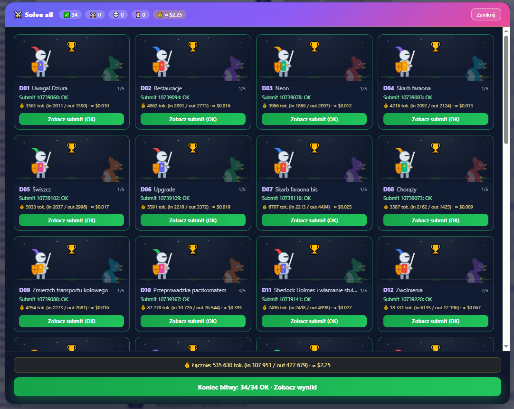
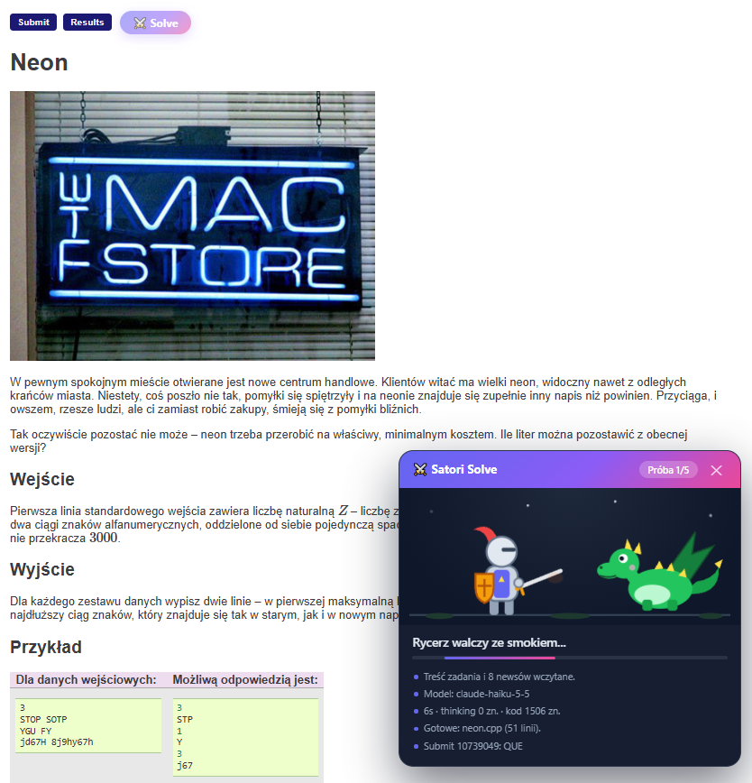
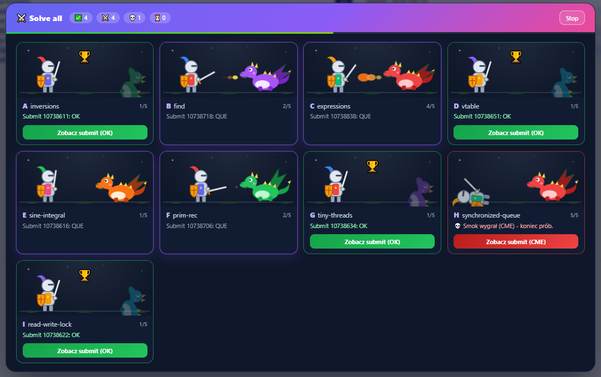
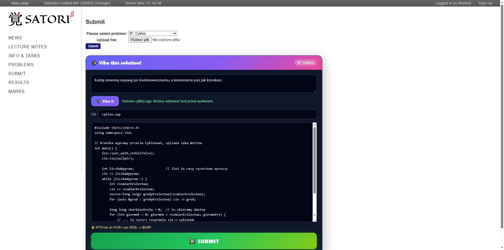
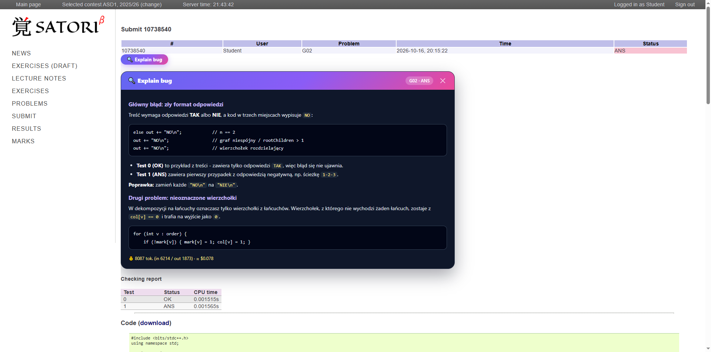
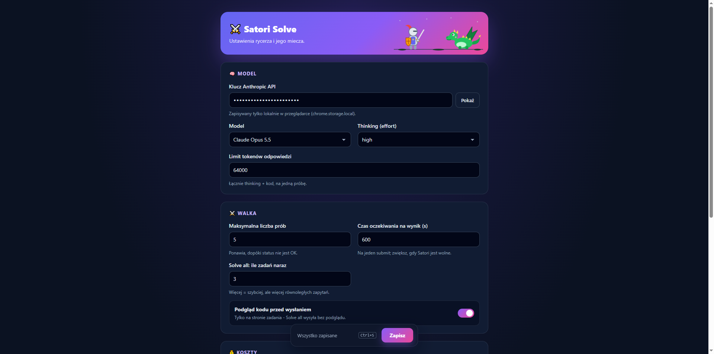

# ⚔️ Satori Solve

Rozszerzenie do Chrome dla [Satori](https://satori.tcs.uj.edu.pl) (sprawdzarki TCS UJ). Rycerz z modelem Claude czyta treść zadania, pisze kod, wysyła go i walczy ze smokiem, dopóki nie dostanie **OK**.

## Co potrafi

### ⚔️ Solve: jedno zadanie
Na stronie zadania pojawia się przycisk **Solve**. Rozszerzenie:
1. czyta treść zadania (razem z wzorami) i **newsy contestu**, bo często są tam ważne zasady,
2. prosi model o rozwiązanie (model sam wybiera język, domyślnie C++17),
3. wysyła kod do Satori i czeka na wynik,
4. jeśli wynik nie jest OK, odsyła modelowi status i raport sprawdzarki, a potem próbuje ponownie (domyślnie do 5 prób).

Na końcu dostajesz duży przycisk **Zobacz submit** oraz zużycie tokenów i szacowany koszt.

### 🐉 Solve all: cały contest
Na liście zadań przycisk **Solve all** rozwiązuje wszystkie zadania, do których można wysyłać (także te z OK). Każde zadanie ma własną arenę z rycerzem i smokiem. Kilka zadań idzie równolegle, a pod każdym zadaniem jest **Historia** wszystkich prób.

### ✨ Vibe this solution!
Na stronie **Submit** pojawia się karta, w której opisujesz, *jak* ma wyglądać kod, np. *„każdą zmienną nazywaj po średniowiecznemu”*. Model pisze rozwiązanie w tym stylu, możesz je poprawić w edytorze, a przycisk **SUBMIT** wysyła je i od razu przenosi na stronę submitu.

### 🔍 Explain bug
Na stronie wyniku submitu przycisk **Explain bug** wysyła modelowi Twój kod, status, raport z testów i treść zadania. Model wskazuje konkretne linie z błędami, wyjaśnia, który test i dlaczego nie przechodzi, i podpowiada poprawkę bez przepisywania całego rozwiązania.

## Instalacja

1. Pobierz repozytorium (`git clone` albo *Code → Download ZIP* i rozpakuj).
2. Otwórz `chrome://extensions` i włącz **Tryb dewelopera**.
3. Kliknij **Załaduj rozpakowane** i wskaż folder z tym repozytorium.
4. Otwórz ustawienia rozszerzenia (*Szczegóły → Opcje rozszerzenia*) i wklej klucz API z [console.anthropic.com](https://console.anthropic.com/).

Po aktualizacji kodu kliknij ⟳ przy rozszerzeniu w `chrome://extensions` i odśwież stronę Satori.

## Ustawienia

| Opcja | Domyślnie | Opis |
| --- | --- | --- |
| Model | Claude Opus 5.5 | Opus, Sonnet albo Haiku. |
| Thinking (effort) | `high` | Ile model „myśli” przed odpowiedzią (`low` / `medium` / `high` albo wyłączony). |
| Limit tokenów odpowiedzi | 64000 | Wspólny limit na thinking i kod, na jedną próbę. |
| Maksymalna liczba prób | 5 | Ile razy ponawiać, dopóki status nie jest OK. |
| Czas oczekiwania na wynik | 600 s | Ile czekać na sprawdzenie submitu; zwiększ, gdy Satori jest wolne. |
| Solve all: ile zadań naraz | 3 | Liczba zadań rozwiązywanych równolegle. |
| Podgląd kodu przed wysłaniem | wł. | Przy **Solve** możesz przejrzeć i poprawić kod przed wysłaniem. Solve all wysyła bez podglądu. |
| Ceny modeli | | Ceny za 1M tokenów (wejście/wyjście) do szacowania kosztu. Sprawdź aktualne na [anthropic.com/pricing](https://www.anthropic.com/pricing). |
| Dodatkowe instrukcje | | Tekst doklejany do każdego zapytania o rozwiązanie. |

## Jak to działa

- **Wysyłanie** to zwykły formularz Satori (`POST /contest/<id>/submit` z polami `problem` i `codefile`), wysyłany z karty Satori. Przeglądarka sama dołącza ciasteczko sesji, więc rozszerzenie nigdy nie widzi Twojego hasła ani ciasteczka.
- **Wynik** jest odczytywany z `/results` co kilka sekund, a przy błędzie raport sprawdzarki trafia z powrotem do modelu.
- **Model** jest wywoływany w service workerze rozszerzenia (Anthropic Messages API, streaming). Klucz API jest zapisany tylko lokalnie w `chrome.storage.local` i nie trafia do stron Satori.
- **Odpowiedzi ucięte** limitem tokenów są obsługiwane osobno: niedokończony blok kodu jest i tak wysyłany, a odpowiedź bez kodu ponawiana bez liczenia próby (najwyżej 2 razy). Model dostaje dokładną informację, dlaczego poprzednia odpowiedź nie została wysłana.

## Pliki

| Plik | Rola |
| --- | --- |
| `manifest.json` | Manifest V3: które skrypty działają na których stronach Satori. |
| `background.js` | Service worker: zapytania do Anthropic API (klucz zostaje tutaj). |
| `solver.js` | Wspólna logika: odczyt treści i newsów, prompt, submit, wyniki, pętla prób, grafika rycerza i smoka. |
| `content.js` | Przycisk **Solve** na stronie zadania. |
| `contest.js` | Przycisk **Solve all** na liście zadań. |
| `submit.js` | Karta **Vibe this solution!** na stronie submitu. |
| `results.js` | Przycisk **Explain bug** na stronie wyniku. |
| `options.html`, `options.js` | Strona ustawień. |
| `settings.js` | Domyślne ustawienia. |

## Uwagi

- Każde zapytanie do modelu kosztuje. Po każdej bitwie widać liczbę tokenów i szacowany koszt, a Solve all przed startem pyta o zgodę i pokazuje maksymalną liczbę submitów.
- Satori zapisuje każdy submit w historii. Używaj rozszerzenia zgodnie z zasadami swojego przedmiotu.
